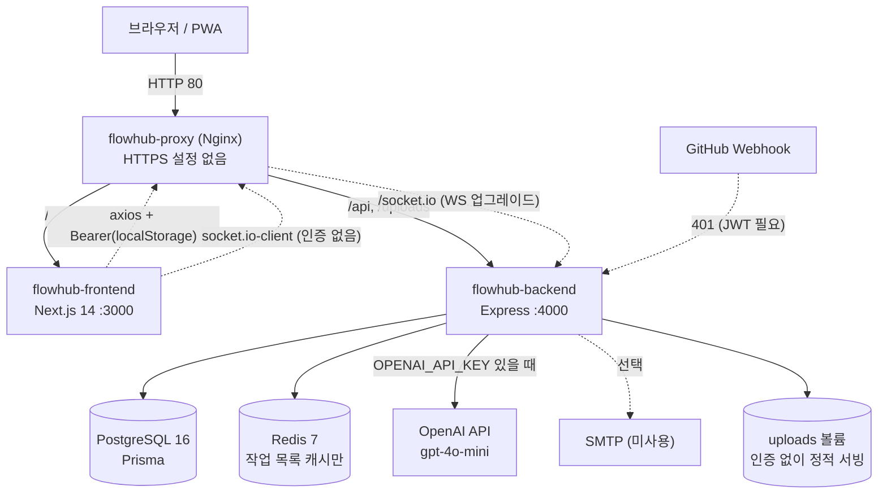
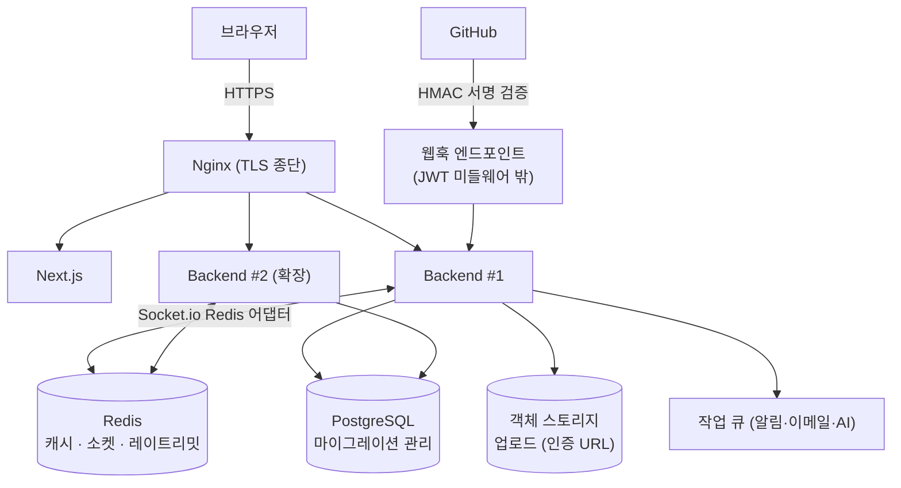
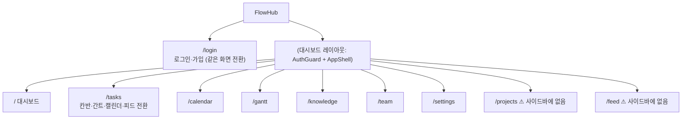

# FlowHub (cert_flowhub) 서비스 정의 보고서 v1.0

> **대상 저장소**: `github.com/kjh9171/cert_flowhub` (main, 최신 커밋 `b8cc018`)
> **작성일**: 2026-11-11
> **분석 방법**: 저장소를 `git clone`으로 직접 받아 추적 파일 **106개를 전수 확인** (백엔드 라우트 14개 모듈·Prisma 스키마·프론트 컴포넌트·Docker/Nginx/CI·설계 문서)
> **구성**: 현황 분석 → 서비스 기획 → 아키텍처 → 기능정의서 → API 정의서 → DB-ERD → UI/UX 정의서 → 핵심 설계 코드 → 갭 분석·로드맵

---

## 0. 이 문서를 읽기 전에

| 구분 | 내용 |
|---|---|
| **표기 규칙** | **[확인]** = 코드에서 직접 확인한 사실 / **[제안]** = 본 문서가 새로 제안하는 설계 |
| **미실행** | 컨테이너를 기동하거나 테스트를 돌려 보지는 않았습니다. 동작 판단은 **코드 정독** 기준입니다. |
| **⚠️ 이전 보고서와의 관계** | 앞서 받으신 `FlowHub_서비스_정의_보고서_v1.0.md`는 **다른 저장소**(`cert_FaLLMwikiDashboard`, Express 마이크로서비스 + 순수 SQL 구조)를 분석한 것입니다. 이 저장소(`cert_flowhub`)는 **Next.js + Express 단일 백엔드 + Prisma** 구조로 코드베이스가 전혀 다릅니다. 두 문서를 혼용하지 마세요. |
| **이름 충돌** | 두 저장소 모두 제품명이 "FlowHub"입니다. 본 문서는 `cert_flowhub`만 다룹니다. |

---

## 1. 현황 분석 (AS-IS)

### 1.1 한 줄 요약

> **개인 일정 · 프로젝트/작업 · 팀 피드 · 지식 베이스를 한 화면에 모은 한국어 협업 플랫폼 (협업툴 "플로우" 스타일).**
> 화면과 API의 **뼈대는 넓게 갖췄지만, 접근 권한 검사가 거의 없고** 프론트 일부는 **가짜(mock) 데이터**를 보여 줍니다. **현 상태로는 여러 사용자가 쓰는 환경에 배포할 수 없는 수준**입니다.

### 1.2 구성 요소 [확인]

| 구성 | 기술 | 포트 | 비고 |
|---|---|---|---|
| `flowhub-proxy` | Nginx 1.27 | 80/443 | `/api`, `/socket.io`, `/uploads`는 백엔드로, 나머지는 프론트로. **HTTPS 설정 없음**(443 포트만 열려 있고 인증서 마운트만 존재) |
| `flowhub-frontend` | Next.js 14.2 (App Router), TS, Tailwind, Zustand, axios | 3000 | PWA(서비스 워커), Sentry 선택 |
| `flowhub-backend` | Node 20, Express 4, Prisma 5, Socket.io 4, JWT, bcryptjs | 4000 | Swagger(`/api/docs`), pino/morgan 로깅, helmet, rate-limit |
| `flowhub-db` | PostgreSQL 16 | 5432(호스트 노출) | 볼륨 `pg_data` |
| `flowhub-redis` | Redis 7 (AOF, 비밀번호) | 6379(호스트 노출) | **현재는 작업 목록 캐시에만 사용** |

저장소 규모: 백엔드 모듈 14개(약 41KB), 프론트 컴포넌트·페이지 약 60개(약 123KB), Prisma 모델 **17개**, Enum **11개**, 테스트 3개 파일(9건).

### 1.3 구현 수준 평가 [확인]

| 영역 | 상태 | 근거 |
|---|---|---|
| 회원가입/로그인 (JWT, bcrypt) | ✅ 동작 | 가입 시 개인 워크스페이스 자동 생성 |
| 작업 CRUD + 담당자 + 알림 | ✅ 동작 | 담당자 지정 시 알림 생성 |
| 칸반(드래그로 상태 변경) | ✅ 동작 | `@dnd-kit`, 낙관적 업데이트 |
| 간트 **표시** | 🟡 부분 | 표시만 됨. **막대를 끌어도 저장되지 않음**(`onDateChange={() => {}}`) |
| 캘린더 | 🟡 부분 | 표시만 됨(드래그 이동 없음) |
| 피드 목록·작성·파일 첨부 | ✅ 동작 | 업로드 후 본문에 링크 |
| 피드 **댓글** | ❌ 미연결 | 백엔드 API는 있으나 프론트 호출 코드 없음 |
| 지식 베이스 CRUD·버전 저장·팀 승격 | ✅ 동작 | 단, 권한 검사 없음(3.3 참조) |
| 지식 에디터 TOC·버전 히스토리 | ❌ 미동작 | TOC 링크 대상 id가 렌더링되지 않고, 히스토리 버튼은 핸들러 없음 |
| 통합 검색 | 🟡 부분 | 서버 검색은 동작하나 결과 클릭 시 **이동 없이 모달만 닫힘**, 초성 검색·파일 검색 없음 |
| 알림 | 🟡 부분 | 목록·읽음 처리 동작. **벨 배지 숫자는 하드코딩(5)** |
| 연동 Badge | ❌ 가짜 | 상단바·대시보드의 Badge는 **고정 문구**("CI/CD 진행중", "PR #42"). API를 호출하지 않음 |
| GitHub 웹훅 | ❌ 사실상 불가 | 인증 미들웨어 뒤에 있어 GitHub이 호출하면 401 (3.3 참조) |
| 사용자 상태(온라인/자리비움…) | 🟡 부분 | 수동 변경만 가능. 접속·종료에 따른 **자동 전환 없음** |
| 대시보드 홈 | 🟡 부분 | 통계 중 **"팀 멤버 8", "미읽음 알림 5"는 고정값**, 하단 피드는 **mock 게시글** |
| 사용자 표시 | ❌ 가짜 | 로그인 사용자와 무관하게 **"홍길동"** 고정 표시(스토어 초기값·사이드바) |
| 프로젝트/워크스페이스 관리 | 🟡 부분 | 목록·생성만. 멤버 초대·삭제·권한 변경 API/화면 없음 |
| RBAC(역할 기반 접근 제어) | ❌ 미적용 | `requireRole` 함수는 정의만 있고 **어디에서도 사용하지 않음** |
| AI 요약/태그 | 🟡 부분 | `OPENAI_API_KEY`가 있으면 실제 호출, 없으면 mock. **프론트에서 호출하는 화면 없음** |
| 캘린더 ICS 내보내기 | 🟡 부분 | API만 있음(UI 없음). Bearer 필수라 캘린더 앱 구독 불가 |
| 이메일 발송 | ❌ 미사용 | `sendEmail` 정의만 있고 호출처 없음 |
| 입력 검증 | ❌ 없음 | `zod`가 의존성에 있으나 **코드에서 한 번도 쓰지 않음** |
| 멘션 | ❌ 미구현 | `Mention` 모델만 있고 생성 코드 없음 |
| DB 마이그레이션 | ❌ 없음 | `prisma/migrations` 폴더 없음, 컨테이너 시작 시 `db push --accept-data-loss` |
| 다국어(i18n) | 🟡 부분 | 사전에 10개 키만 있음(메뉴 이름 정도) |
| 자동 테스트 | 🟡 최소 | 백엔드 3파일 9건(인증·작업·헬스). **프론트 테스트 0** |

### 1.4 문서 ↔ 코드 불일치 [확인]

| # | 문서의 주장 | 실제 코드 |
|---|---|---|
| 1 | README §5: `prisma migrate deploy`로 마이그레이션 | 마이그레이션 파일이 **없음**. 실제로는 컨테이너 시작 시 `db push --accept-data-loss` 실행 |
| 2 | README §7: 4단계(Redis 캐싱·RBAC·업로드·테스트·CI/CD) "예정" | 캐싱·업로드·테스트·CI는 **이미 구현**, 반면 RBAC는 **여전히 미적용** → README가 현실과 어긋남 |
| 3 | README §2.2: Redis "세션/캐시/Pub-Sub" | 캐시만 사용. 세션·Pub-Sub·Socket.io Redis 어댑터 없음 → **서버를 2대로 늘리면 실시간 이벤트가 끊김** |
| 4 | 설계서 §3.7: 간트 드래그 → API PATCH + 소켓 브로드캐스트 | 드래그 핸들러가 **빈 함수** |
| 5 | 설계서 §3.2: Cmd/Ctrl+K 검색 단축키 | 단축키 구현 코드 **없음**(버튼 클릭만) |
| 6 | 설계서 §3.2: 연동 Badge 집계 | 고정 문구 |
| 7 | 설계서 §5: 실패 시 **롤백** + 에러 토스트 | 실패해도 낙관적 상태를 **그대로 유지**(`keep optimistic`), 토스트 없음 |
| 8 | 설계서 §3.12: 초성 검색 | 미구현 |
| 9 | 설계서 §3.11: Tiptap WYSIWYG | 실제는 `textarea` + 미리보기 |
| 10 | Swagger `/api/docs` | `apis: []`라서 **엔드포인트가 하나도 문서화되지 않음** |
| 11 | CI(`npm ci`) | 저장소에 `package-lock.json`이 **없어** `npm ci`는 실패할 가능성이 높음(CI 실행 이력은 확인 못함) |
| 12 | 프론트 `next lint` 스크립트 | ESLint 설정·의존성 없음 |
| 13 | PWA 매니페스트 아이콘 | `icon-192.png`, `icon-512.png` 파일 **없음** |

---

## 2. 서비스 기획

### 2.1 비전

> **"일정·작업·대화·지식이 흩어지지 않고, 한 워크스페이스 안에서 서로 연결되는 팀 협업 공간"**

### 2.2 문제 정의와 해법

| # | 문제 | FlowHub의 해법 | 구현 상태 |
|---|---|---|---|
| P1 | 일정(간트)·작업(칸반)·소통(피드)이 각각 다른 도구 | 하나의 앱에서 **뷰 전환**(피드/칸반/캘린더/간트) | 칸반 ✅, 간트·캘린더 표시만 🟡 |
| P2 | 개발 진행 상황(PR·CI)이 협업 도구에 안 보임 | **연동 Badge**(GitHub 커밋/PR/CI·배포) 실시간 반영 | ❌ 가짜 |
| P3 | 개인 메모가 팀 지식으로 못 올라감 | 개인/팀 공간 분리 + **1-Click 팀 승격** | 🟡 (권한 결함) |
| P4 | 동료가 지금 무엇을 하는지 모름 | **사용자 상태**(온라인/자리비움/다른 업무 중/오프라인) | 🟡 수동만 |
| P5 | 정보를 찾기 어려움 | 문서·작업·피드·파일 **통합 검색** | 🟡 |

### 2.3 사용자·권한 모델 [확인]

권한이 **3중 구조**로 정의되어 있으나 **실제로 쓰이는 것은 1개뿐**입니다.

| 권한 축 | 값 | 저장 위치 | 실제 집행 |
|---|---|---|---|
| 전역 역할 `UserRole` | ADMIN / MEMBER / VIEWER | `User.role` (JWT에 포함) | ❌ 가입 시 항상 `MEMBER`, 검사하는 곳 없음 |
| 워크스페이스 역할 `WorkspaceRole` | OWNER / ADMIN / MEMBER / GUEST | `WorkspaceMember.role` | ❌ 조회·수정 시 **멤버십 확인 자체가 없음** |
| 프로젝트 역할 `ProjectRole` | OWNER / MANAGER / MEMBER / VIEWER | `ProjectMember.role` | ❌ 미사용 |

> **핵심 문제**: 로그인만 하면 **다른 워크스페이스의 데이터를 읽고 수정·삭제**할 수 있습니다(3.3절 S1).

**[제안] 단순화**: 전역 역할은 "시스템 관리자 여부" 정도로 축소하고, **워크스페이스 역할(OWNER/ADMIN/MEMBER/GUEST)을 단일 기준**으로 삼으세요. 프로젝트 역할은 2단계(MANAGER/MEMBER) 정도로 줄이는 것을 권장합니다.

### 2.3.1 페르소나 **[제안]**

| 페르소나 | 설명 | 핵심 니즈 | 주 기능 |
|---|---|---|---|
| **개발팀 리더** | 5~15인 개발팀 | 진행 현황·배포 상태 한눈에 | 칸반, 간트, 연동 Badge |
| **팀원** | 작업 수행자 | 내 할 일, 알림, 문서 찾기 | 작업, 피드, 검색, 알림 |
| **지식 담당자** | 노하우를 문서화 | 개인 메모 → 팀 문서 | 지식 베이스, 승격 |
| **게스트(외부)** | 협력사·고객 | 지정 프로젝트만 열람 | 읽기 전용 |

### 2.4 KPI **[제안]**

| 지표 | 정의 | 목표 |
|---|---|---|
| 주간 활성 팀원 비율 | 주 1회 이상 접속 / 전체 | 80% |
| 작업 갱신 지연 | 상태 변경까지 걸린 시간 | 24h 이내 |
| 팀 승격률 | 개인 문서 중 팀으로 승격된 비율 | 20% |
| 검색 성공률 | 검색 후 결과 클릭 비율 | 70% |
| 연동 이벤트 수신 성공률 | GitHub 웹훅 처리 성공 / 전체 | 99% |

### 2.5 범위 구분

| 구분 | 포함 |
|---|---|
| **지금 해야 할 일(R0)** | 접근 권한 검사, 소켓 인증, 비밀키 검증, 업로드 보안, 서비스 워커 정리 |
| **MVP 완성(R1~R3)** | 간트 드래그 저장, 댓글, 연동 Badge 실데이터, 멤버 초대, 마이그레이션 체계 |
| **이후** | 멘션, 외부 캘린더 동기화, 알림 이메일, 초성 검색, 모바일 앱 |

---

## 3. 시스템 아키텍처

### 3.1 현재 구조 (AS-IS) [확인]



### 3.2 설계상 특징과 위험 [확인]

| 특징 | 설명 | 평가 |
|---|---|---|
| **모놀리식 백엔드** | 단일 Express 앱에 14개 모듈 | 현재 규모에 **적절**. 마이크로서비스 분리 불필요 |
| **전체 방송(broadcast)** | `io.emit(...)`로 **접속한 모든 클라이언트**에 이벤트 전송 | 🔴 다른 팀의 작업·알림이 유출됨 |
| **소켓 인증 없음** | 연결 시 토큰 검증 없음, 클라이언트가 보낸 이벤트를 그대로 재전파 | 🔴 위조 이벤트 주입 가능 |
| **Redis 캐시 키에 사용자·권한 미반영** | 키 = `tasks:{projectId}:{workspaceId}:{status}:{assigneeId}` | 🔴 캐시 적중 시 **권한 없는 사용자도 동일 응답** |
| **캐시 무효화에 `KEYS` 사용** | `tasks:*` 전체 키를 훑어 삭제 | 🟠 키가 많아지면 Redis 블로킹 |
| **`trust proxy` 미설정** | Nginx 뒤에서 모든 요청의 IP가 프록시 IP로 보임 | 🟠 rate-limit(15분 300회)이 **전 사용자 공통 한도**가 될 가능성 |
| **오류 응답에 내부 메시지 노출** | `errorHandler`가 모든 오류의 `message`를 그대로 반환 | 🟠 Prisma 오류 문구 등 내부 정보 유출 |
| **프론트 Mock 폴백** | API 실패 시 mock 작업 4건을 그대로 표시(초기값이 mock) | 🟠 사용자가 가짜 데이터를 **실제 데이터로 오인** |
| **스키마 반영 방식** | 시작 시 `prisma db push --accept-data-loss` | 🔴 스키마 변경이 **데이터 삭제**를 유발할 수 있음 |

### 3.3 목표 구조 (TO-BE) **[제안]**



| 변경 | 이유 |
|---|---|
| 모든 데이터 접근에 **워크스페이스 멤버십 검사 미들웨어** | S1(타 워크스페이스 접근) 해소 |
| 소켓 **JWT 인증 + 워크스페이스 룸** | 전체 방송 제거, 위조 방지 |
| 웹훅 라우트를 **인증 미들웨어 앞**으로 이동 + HMAC 검증 | 실제로 동작하게 하고 위조 방지 |
| Socket.io **Redis 어댑터** | 서버 다중화 시 실시간 유지 |
| `db push` 폐지 → **`prisma migrate`** | 데이터 손실 방지 |
| 업로드를 **인증된 다운로드 URL**로 제공 | 저장형 XSS·무단 열람 차단 |

---

## 4. 기능정의서

> 상태: ✅ 구현 / 🟡 부분 / ❌ 미구현 · 우선순위: **P0**(즉시) / P1 / P2

### 4.1 인증·계정 (AUTH)

| ID | 기능 | 상태 | 설명 | 우선 |
|---|---|---|---|---|
| AUTH-01 | 회원가입 | ✅ | 이메일·비밀번호·이름, 개인 워크스페이스(`ws-<id 앞 8자>`) 자동 생성 | P0 보완: 비밀번호·이메일 검증 |
| AUTH-02 | 로그인 | ✅ | bcrypt 비교, JWT(7일), 상태 ONLINE 전환 | P0 보완: 로그인 시도 제한 |
| AUTH-03 | 내 정보 조회/수정 | ✅ | `GET/PATCH /users/me` (이름·상태 메시지) | - |
| AUTH-04 | 로그아웃 | 🟡 | 프론트가 토큰만 삭제. **서버 상태를 OFFLINE으로 바꾸지 않음** | P1 |
| AUTH-05 | 비밀번호 변경/재설정 | ❌ | - | P1 |
| AUTH-06 | 이메일 인증 | ❌ | `sendEmail` 있으나 미사용 | P2 |
| AUTH-07 | 토큰 갱신/폐기 | ❌ | 7일 단일 토큰, 폐기 수단 없음 | P1 |
| AUTH-08 | 데모 계정 미리 채움 제거 | ❌ | 로그인 폼에 `demo@flowhub.local / password123`가 **기본 입력**됨 | **P0** |

### 4.2 워크스페이스·프로젝트 (WS / PRJ)

| ID | 기능 | 상태 | 설명 | 우선 |
|---|---|---|---|---|
| WS-01 | 워크스페이스 목록/생성 | ✅ | 생성 시 OWNER 멤버 등록 | - |
| WS-02 | 워크스페이스 조회/수정 | 🟡 | **멤버십·역할 확인 없음** | **P0** |
| WS-03 | 멤버 초대·제거·역할 변경 | ❌ | 엔드포인트 없음 | P1 |
| WS-04 | 워크스페이스 전환 | 🟡 | 상단바 드롭다운은 고정 항목 | P1 |
| PRJ-01 | 프로젝트 목록/생성 | ✅ | 생성자가 OWNER | - |
| PRJ-02 | 프로젝트 수정/삭제 | 🟡 | **권한 확인 없음**(아무나 삭제 가능) | **P0** |
| PRJ-03 | 프로젝트 멤버 관리 | ❌ | - | P1 |
| PRJ-04 | 기본 뷰 저장 | 🟡 | `viewType` 컬럼만 있음 | P2 |
| PRJ-05 | 사이드바 프로젝트 목록 | ❌ | `p1`, `p2` 고정 항목 | P1 |

### 4.3 작업 (TASK)

| ID | 기능 | 상태 | 설명 | 우선 |
|---|---|---|---|---|
| TSK-01 | 작업 CRUD | ✅ | 제목·내용·상태(5)·우선순위(4)·진척도·시작/종료/마감 | P0 보완: 권한 |
| TSK-02 | 담당자 지정(복수) | 🟡 | 백엔드 ✅, **생성 폼에는 담당자 입력 없음** | P1 |
| TSK-03 | 서브태스크 | 🟡 | `parentId` 컬럼만 있고 API·UI 없음 | P1 |
| TSK-04 | 의존성(FS/SS/FF/SF + 지연일) | 🟡 | 추가/삭제 API ✅, **자기참조·순환 검증 없음**, UI 없음 | P1 |
| TSK-05 | 칸반 뷰 | ✅ | 4열(요청/진행/일시정지/완료) 드래그. **`CANCELLED` 열 없음** | - |
| TSK-06 | 칸반 열 내 순서 저장 | ❌ | 순서 필드 자체가 없음 | P1 |
| TSK-07 | 간트 뷰 | 🟡 | 표시만, 드래그·진척도 변경 **미저장** | **P0** |
| TSK-08 | 캘린더 뷰 | 🟡 | 표시만 | P1 |
| TSK-09 | 작업 상세 패널 | ✅ | 제목·내용·상태·우선순위·진척도 수정 | - |
| TSK-10 | 작업 댓글 | ❌ | `Comment.taskId`는 있으나 API 없음 | P1 |
| TSK-11 | 작업 필터(내 작업·상태·프로젝트) | 🟡 | API는 지원, **UI 없음** | P1 |
| TSK-12 | 실패 시 롤백 | ❌ | 낙관적 업데이트가 실패해도 유지 | **P0** |
| TSK-13 | 진행 중 `CANCELLED` 처리 | ❌ | 상태는 있으나 화면에서 볼 수 없음 | P2 |

### 4.4 피드·협업 (FEED)

| ID | 기능 | 상태 | 설명 | 우선 |
|---|---|---|---|---|
| FED-01 | 글 목록(유형 필터) | ✅ | 요청/업무/일지/공유/공지, 고정글 우선 정렬 | - |
| FED-02 | 글 작성·수정·삭제 | 🟡 | 작성 ✅. 수정·삭제 UI 없음, **권한 확인 없음**(작성자 아닌 사용자도 수정·삭제 가능) | **P0** |
| FED-03 | 파일 첨부 | 🟡 | 업로드 후 본문에 링크 삽입. 첨부 레코드 연결은 안 함 | P1 |
| FED-04 | 댓글/대댓글 | ❌ | API ✅(알림 포함), **프론트 미연결** | P1 |
| FED-05 | 멘션 | ❌ | 모델만 존재 | P2 |
| FED-06 | 공지 고정 | 🟡 | `isPinned` 있으나 UI 없음 | P2 |
| FED-07 | 피드 메뉴 노출 | ❌ | `/feed` 페이지는 있으나 **사이드바에 링크 없음** | P1 |

### 4.5 지식 베이스 (KB)

| ID | 기능 | 상태 | 설명 | 우선 |
|---|---|---|---|---|
| KB-01 | 문서 CRUD | 🟡 | 삭제 UI 없음 | - |
| KB-02 | 개인/팀/공개 구분 | ❌ | **서버가 가시성을 강제하지 않음** → 타인의 개인 문서 열람·수정 가능 | **P0** |
| KB-03 | 1-Click 팀 승격 | 🟡 | 동작은 하나 **권한 확인 없음**, `promotedFromId`에 **자기 자신 ID**가 저장되는 버그 | **P0** |
| KB-04 | 버전 저장 | 🟡 | 저장 시 자동 생성. **버전 번호 경쟁 상태**(동시 저장 시 중복 가능). 복원·비교 UI 없음 | P1 |
| KB-05 | 마크다운 에디터 | ✅ | textarea + 미리보기(분할 보기) | - |
| KB-06 | TOC 자동 생성 | ❌ | 목록은 생성되나 **링크 대상 id가 렌더되지 않아 이동 안 됨** | P1 |
| KB-07 | 문서 스타일 | ❌ | `prose` 클래스를 쓰지만 typography 플러그인이 없어 **스타일 미적용** | P1 |
| KB-08 | 계층(폴더) | 🟡 | `parentId` 모델만 있음 | P2 |
| KB-09 | 관련 작업 링크 | ❌ | `KnowledgeLink` 모델만 있음 | P2 |
| KB-10 | 문서 댓글 | ❌ | 모델만 있음 | P2 |

### 4.6 연동 Badge (INTEG)

| ID | 기능 | 상태 | 설명 | 우선 |
|---|---|---|---|---|
| INT-01 | Badge CRUD API | ✅ | 상태 4종 × 이벤트 5종 | P0 보완: 권한 |
| INT-02 | GitHub 웹훅 수신 | ❌ | 인증 미들웨어에 막혀 **GitHub이 호출 불가**. 서명 검증도 없음(`GITHUB_WEBHOOK_SECRET` 미사용) | **P0** |
| INT-03 | 웹훅 → 프로젝트/작업 연결 | ❌ | 생성되는 Badge에 **workspace·project·task 정보가 없음**(어디에도 소속되지 않음) | **P0** |
| INT-04 | Badge 화면 표시 | ❌ | 프론트는 **고정 문구**만 표시 | **P0** |
| INT-05 | 실시간 갱신 | ❌ | 수신 코드 없음(서버는 `badge:updated` 방송) | P1 |
| INT-06 | Slack 연동 | ❌ | 환경변수 항목만 있음 | P2 |

### 4.7 사용자 상태·알림 (PRES / NOTI)

| ID | 기능 | 상태 | 설명 | 우선 |
|---|---|---|---|---|
| PRS-01 | 수동 상태 변경 | ✅ | 4종 + 상태 메시지 | - |
| PRS-02 | 상태 실시간 전파 | ❌ | API 변경 시 방송하지 않음(`main에서 처리`라는 주석만 있고 구현 없음) | P1 |
| PRS-03 | 접속/종료 자동 전환 | ❌ | 소켓 연결·해제에 상태 연동 없음 | P1 |
| NOT-01 | 알림 목록(최근 50건)·읽음 | ✅ | - | - |
| NOT-02 | 알림 대상 | 🟡 | 작업 할당·피드 댓글만 생성 | P1 |
| NOT-03 | 읽음 처리 권한 | ❌ | **다른 사람의 알림도 읽음 처리 가능** | **P0** |
| NOT-04 | 실시간 알림 | 🔴 | `io.emit` 전체 방송 → **모든 접속자가 모든 알림을 수신**, 패널이 그대로 목록에 추가 | **P0** |
| NOT-05 | 벨 배지 미읽음 수 | ❌ | `5` 고정 | P1 |
| NOT-06 | 이메일 알림 | ❌ | - | P2 |

### 4.8 검색·통계·기타 (SRCH / STAT / MISC)

| ID | 기능 | 상태 | 설명 | 우선 |
|---|---|---|---|---|
| SRC-01 | 통합 검색(작업·문서·피드) | 🟡 | `contains` 검색. **타인의 개인 문서까지 검색됨** | **P0** |
| SRC-02 | 고급 검색(FTS) | 🟡 | `to_tsquery`에 입력을 그대로 넣어 **특수문자 입력 시 500 오류**, 인덱스 없음, 프론트 미사용 | P1 |
| SRC-03 | 결과 이동 | ❌ | 클릭 시 모달만 닫힘 | P1 |
| SRC-04 | 초성·파일 검색 | ❌ | - | P2 |
| SRC-05 | Cmd/Ctrl+K | ❌ | 단축키 없음 | P1 |
| STA-01 | 대시보드 통계 API | 🟡 | 연동 Badge 집계가 **워크스페이스 구분 없이 전체 집계** | P1 |
| STA-02 | 대시보드 통계 화면 | ❌ | 화면은 API를 쓰지 않고 로컬 값/고정값 사용 | P1 |
| CAL-01 | ICS 내보내기 | 🟡 | 이스케이프 미처리(쉼표·세미콜론·줄바꿈), 토큰 구독 불가 | P2 |
| AI-01 | 요약·태그 | 🟡 | 키 없으면 mock. **UI 없음**, 사용자별 한도 없음 | P2 |
| UPL-01 | 파일 업로드(50MB) | 🟡 | 형식 제한 없음, **인증 없이 정적 서빙** | **P0** |

---

## 5. 데이터베이스 설계 (ERD)

### 5.1 현재 스키마 ERD [확인]

```mermaid
erDiagram
    USER ||--o{ WORKSPACE : "소유(ownerId)"
    USER ||--o{ WORKSPACE_MEMBER : "소속"
    WORKSPACE ||--o{ WORKSPACE_MEMBER : "구성원"
    WORKSPACE ||--o{ PROJECT : "보유"
    PROJECT ||--o{ PROJECT_MEMBER : "구성원"
    USER ||--o{ PROJECT_MEMBER : "참여"
    USER ||--o{ PROJECT : "소유(ownerId)"

    PROJECT ||--o{ TASK : "작업"
    USER ||--o{ TASK : "작성(authorId)"
    TASK ||--o{ TASK : "서브태스크(parentId)"
    TASK ||--o{ TASK_ASSIGNEE : "담당"
    USER ||--o{ TASK_ASSIGNEE : "담당자"
    TASK ||--o{ TASK_DEPENDENCY : "후행(taskId)"
    TASK ||--o{ TASK_DEPENDENCY : "선행(dependsOnTaskId)"

    WORKSPACE ||--o{ FEED_POST : "피드"
    PROJECT ||--o{ FEED_POST : "프로젝트 피드"
    USER ||--o{ FEED_POST : "작성"
    FEED_POST ||--o{ COMMENT : "댓글"
    TASK ||--o{ COMMENT : "작업 댓글"
    KNOWLEDGE_ARTICLE ||--o{ COMMENT : "문서 댓글"
    COMMENT ||--o{ COMMENT : "대댓글"
    USER ||--o{ COMMENT : "작성"
    USER ||--o{ MENTION : "언급됨"
    FEED_POST ||--o{ MENTION : "포함"
    COMMENT ||--o{ MENTION : "포함"
    TASK ||--o{ MENTION : "포함"

    FEED_POST ||--o{ ATTACHMENT : "첨부"
    TASK ||--o{ ATTACHMENT : "첨부"
    KNOWLEDGE_ARTICLE ||--o{ ATTACHMENT : "첨부"
    USER ||--o{ ATTACHMENT : "업로드"

    WORKSPACE ||--o{ KNOWLEDGE_ARTICLE : "문서"
    USER ||--o{ KNOWLEDGE_ARTICLE : "작성"
    KNOWLEDGE_ARTICLE ||--o{ KNOWLEDGE_ARTICLE : "계층(parentId)"
    KNOWLEDGE_ARTICLE ||--o{ KNOWLEDGE_VERSION : "버전"
    USER ||--o{ KNOWLEDGE_VERSION : "편집"
    KNOWLEDGE_ARTICLE ||--o{ KNOWLEDGE_LINK : "링크"

    TASK ||--o{ INTEGRATION_BADGE : "연동"
    PROJECT ||--o{ INTEGRATION_BADGE : "연동"
    WORKSPACE ||--o{ INTEGRATION_BADGE : "연동"
    USER ||--o{ INTEGRATION_BADGE : "행위자(actorId)"
    USER ||--o{ NOTIFICATION : "수신"

    USER {
        string id PK "cuid"
        string email UK
        string passwordHash "bcrypt"
        string name
        enum role "ADMIN/MEMBER/VIEWER"
        enum status "ONLINE/AWAY/BUSY/OFFLINE"
        string statusMessage
        datetime lastSeenAt
    }
    WORKSPACE {
        string id PK
        string slug UK
        string ownerId FK
    }
    WORKSPACE_MEMBER {
        string workspaceId FK "복합 UK"
        string userId FK "복합 UK"
        enum role "OWNER/ADMIN/MEMBER/GUEST"
    }
    PROJECT {
        string id PK
        string workspaceId FK
        string color "HEX"
        enum viewType "FEED/KANBAN/CALENDAR/GANTT"
        boolean isArchived
    }
    TASK {
        string id PK
        string projectId FK "SetNull"
        string workspaceId "FK 아님(문자열)"
        string parentId FK "서브태스크"
        enum status "REQUESTED..CANCELLED"
        enum priority "URGENT..LOW"
        int progress "0-100"
        datetime startDate
        datetime endDate
        datetime dueDate
    }
    TASK_DEPENDENCY {
        string taskId FK "후행"
        string dependsOnTaskId FK "선행"
        enum type "FS/SS/FF/SF"
        int lagDays
    }
    FEED_POST {
        string id PK
        string workspaceId FK
        enum type "REQUEST/TASK/JOURNAL/SHARE/ANNOUNCEMENT"
        boolean isPinned
    }
    COMMENT {
        string id PK
        string postId FK "택1(제약 없음)"
        string taskId FK "택1(제약 없음)"
        string knowledgeArticleId FK "택1(제약 없음)"
        string parentId FK
    }
    KNOWLEDGE_ARTICLE {
        string id PK
        string workspaceId FK "NULL 허용"
        enum visibility "PERSONAL/TEAM/PUBLIC"
        string_array tags
        int version
        string promotedFromId "FK 아님"
    }
    KNOWLEDGE_VERSION {
        string articleId FK "복합 UK"
        int version "복합 UK"
        string changeNote
    }
    INTEGRATION_BADGE {
        string id PK
        enum status "SUCCESS/IN_PROGRESS/FAILED/PENDING"
        enum eventType "COMMIT/PULL_REQUEST/CI_CD/DEPLOY/EXTERNAL_API"
        json metadata
        string taskId FK
        string projectId FK
        string workspaceId FK
    }
    NOTIFICATION {
        string id PK
        string userId FK
        enum type "8종"
        boolean isRead
    }
    ATTACHMENT {
        string id PK
        string fileUrl
        int fileSize
        string mimeType
    }
    MENTION {
        string id PK
        string userId FK
    }
    KNOWLEDGE_LINK {
        string id PK
        string taskId "FK 아님"
        string url
    }
    TASK_ASSIGNEE {
        string taskId FK "복합 UK"
        string userId FK "복합 UK"
    }
    PROJECT_MEMBER {
        string projectId FK "복합 UK"
        string userId FK "복합 UK"
        enum role "OWNER/MANAGER/MEMBER/VIEWER"
    }
```



### 5.2 구조적 결함 목록 [확인]

| # | 결함 | 영향 | 해결 방향 |
|---|---|---|---|
| D1 | `Task.workspaceId`가 **관계 없는 문자열** | 존재하지 않는 워크스페이스 ID 저장 가능, 삭제 시 고아 데이터 | `Workspace` 관계(FK) 추가 |
| D2 | `Task.projectId`가 null 허용 + 워크스페이스도 null 허용 | 어디에도 속하지 않는 작업 생성 가능 | 둘 중 하나는 필수 |
| D3 | `Comment`/`Attachment`/`Mention`의 대상 FK 3개가 모두 nullable, **정확히 하나만 채워지는 제약 없음** | 대상이 없거나 여러 개인 레코드 가능 | DB `CHECK` 제약 |
| D4 | `TaskDependency`에 **자기참조·순환 방지 없음** | 간트 계산 무한 루프·오류 | `CHECK (taskId <> dependsOnTaskId)` + 앱 순환 검사 |
| D5 | `KnowledgeArticle.promotedFromId`가 FK 아님, 승격 코드가 **자기 ID를 저장** | 원본 추적 불가 | 승격 시 **복사본 생성** + 원본 ID 저장 |
| D6 | `KnowledgeArticle.workspaceId` null 허용 | 개인 문서가 워크스페이스 없이 존재 → 검색 범위 불명확 | 개인 문서도 워크스페이스 귀속 |
| D7 | 전문 검색 인덱스 없음 | 문서가 늘면 검색 느려짐 | GIN 인덱스(+`pg_trgm`) |
| D8 | 칸반 **열 내 순서** 필드 없음 | 새로고침 시 순서 초기화 | `position` 컬럼 |
| D9 | `IntegrationBadge`에 웹훅 출처 식별 필드 부족(저장소·워크스페이스 매핑 없음) | 어느 팀 Badge인지 알 수 없음 | `IntegrationSource` 테이블 |
| D10 | 감사 로그 없음 | 권한 문제·삭제 추적 불가 | `AuditLog` 신설 |
| D11 | 삭제가 전부 **물리 삭제** | 실수로 지운 데이터 복구 불가 | `deletedAt`(소프트 삭제) |
| D12 | 권한 컬럼이 3곳(`User.role`, `WorkspaceMember.role`, `ProjectMember.role`) | 기준 혼란 | 2.3절 단순화 |
| D13 | 마이그레이션 이력 없음 | 변경 추적·롤백 불가 | `prisma migrate` 도입 |
| D14 | `User.status`가 접속과 무관하게 남음 | 로그아웃해도 ONLINE 유지 | 프레즌스(Redis TTL) |

### 5.3 개선 스키마 **[제안]**

> 아래는 **변경 부분만** 담은 Prisma 스키마 조각입니다. 모든 라인에 의도를 한글 주석으로 설명했습니다.

```prisma
// ───────────── Task: 워크스페이스 FK, 정렬 순서, 소프트 삭제 추가 (D1, D2, D8, D11) ─────────────
model Task {
  id          String       @id @default(cuid())          // 작업 식별자(추측이 어려운 cuid)
  workspaceId String                                     // 워크스페이스를 필수로 만들어 소속 불명 작업을 막는다 (기존: 선택 + 관계 없음)
  workspace   Workspace    @relation(fields: [workspaceId], references: [id], onDelete: Cascade) // 실제 FK 관계로 무결성 보장
  projectId   String?                                    // 프로젝트는 선택(개인 작업 허용)
  project     Project?     @relation(fields: [projectId], references: [id], onDelete: SetNull) // 프로젝트 삭제 시 작업은 남기고 연결만 해제
  title       String                                     // 작업 제목
  content     String?      @db.Text                      // 작업 설명(길이 제한 없는 텍스트)
  status      TaskStatus   @default(REQUESTED)           // 상태 기본값은 '요청'
  position    Float        @default(0)                   // 칸반 열 안에서의 순서(사이 삽입이 쉽도록 실수형)
  progress    Int          @default(0)                   // 진척도 0~100 (범위 검증은 아래 raw SQL의 CHECK가 담당)
  deletedAt   DateTime?                                  // 값이 있으면 삭제된 것으로 간주(소프트 삭제, 복구 가능)
  @@index([workspaceId, status, position])               // 칸반 조회(워크스페이스+상태+순서) 가속
  @@index([workspaceId, deletedAt])                      // 삭제되지 않은 목록 조회 가속
  @@map("tasks")                                         // 기존 테이블 이름 유지
}

// ───────────── 감사 로그: 누가 무엇을 했는지 기록 (D10) ─────────────
model AuditLog {
  id          String    @id @default(cuid())             // 로그 식별자
  workspaceId String?                                    // 대상 워크스페이스(시스템 이벤트는 NULL)
  actorId     String?                                    // 행위자 — 사용자 삭제 후에도 기록을 남기려고 관계는 두지 않는다
  action      String                                     // 행위명(task.delete, article.promote, auth.login 등)
  targetType  String?                                    // 대상 종류(task/article/workspace…)
  targetId    String?                                    // 대상 ID
  meta        Json?                                      // IP·변경 전후 값 등 부가 정보
  createdAt   DateTime  @default(now())                  // 발생 시각
  @@index([workspaceId, createdAt])                      // 관리자 화면의 최신순 조회 가속
  @@index([actorId, createdAt])                          // 특정 사용자 행위 추적 가속
  @@map("audit_logs")                                    // 테이블 이름
}

// ───────────── 연동 소스: 웹훅이 어느 워크스페이스/프로젝트 것인지 식별 (D9) ─────────────
model IntegrationSource {
  id          String    @id @default(cuid())             // 소스 식별자
  workspaceId String                                     // 이 소스가 속한 워크스페이스
  workspace   Workspace @relation(fields: [workspaceId], references: [id], onDelete: Cascade) // 워크스페이스 삭제 시 함께 삭제
  projectId   String?                                    // 특정 프로젝트에만 연결할 경우
  provider    String                                     // 'github' 등 제공자
  repoFullName String                                    // 'owner/repo' — 웹훅 payload의 저장소와 대조해 출처를 식별한다
  secretHash  String                                     // 웹훅 서명 비밀키(평문 저장 금지: 암호화 또는 해시 보관)
  createdAt   DateTime  @default(now())                  // 등록 시각
  @@unique([provider, repoFullName])                     // 같은 저장소가 두 번 등록되지 않게 한다
  @@map("integration_sources")                           // 테이블 이름
}
```

```sql
-- =====================================================================
-- 마이그레이션 보강 SQL (Prisma로 표현할 수 없는 제약·인덱스)
-- 사용: prisma migrate dev --create-only 로 만든 빈 마이그레이션에 붙여 넣는다
-- =====================================================================

-- 진척도가 0~100을 벗어나는 값이 DB에 저장되지 않도록 제약을 건다 (현재는 앱에서 검증 없음)
ALTER TABLE tasks ADD CONSTRAINT chk_tasks_progress CHECK (progress BETWEEN 0 AND 100);

-- 시작일이 종료일보다 늦은 작업(간트가 깨지는 데이터)을 DB 차원에서 차단한다
ALTER TABLE tasks ADD CONSTRAINT chk_tasks_dates
  CHECK ("startDate" IS NULL OR "endDate" IS NULL OR "endDate" >= "startDate");

-- 자기 자신을 선행으로 지정하는 가장 단순한 순환을 차단한다 (D4)
ALTER TABLE task_dependencies ADD CONSTRAINT chk_dep_self CHECK ("taskId" <> "dependsOnTaskId");

-- 댓글은 정확히 하나의 대상(게시글·작업·문서)에만 달려야 한다 (D3)
ALTER TABLE comments ADD CONSTRAINT chk_comment_one_target CHECK (
  (("postId" IS NOT NULL)::int + ("taskId" IS NOT NULL)::int + ("knowledgeArticleId" IS NOT NULL)::int) = 1
);

-- 첨부파일도 정확히 하나의 대상에만 붙도록 제약한다 (D3)
ALTER TABLE attachments ADD CONSTRAINT chk_attachment_one_target CHECK (
  (("postId" IS NOT NULL)::int + ("taskId" IS NOT NULL)::int + ("knowledgeArticleId" IS NOT NULL)::int) = 1
);

-- 한국어 부분 일치 검색(LIKE)을 가속하기 위해 trigram 확장을 켠다 (D7)
CREATE EXTENSION IF NOT EXISTS pg_trgm;

-- 작업 제목 부분 검색용 GIN 인덱스 (contains 검색이 인덱스를 타게 한다)
CREATE INDEX idx_tasks_title_trgm ON tasks USING gin (title gin_trgm_ops);

-- 문서 제목·본문 부분 검색용 GIN 인덱스
CREATE INDEX idx_articles_title_trgm ON knowledge_articles USING gin (title gin_trgm_ops);
CREATE INDEX idx_articles_content_trgm ON knowledge_articles USING gin (content gin_trgm_ops);

-- 문서 전문 검색(to_tsvector) 인덱스: 현재 고급 검색이 인덱스 없이 전체를 훑고 있다
CREATE INDEX idx_articles_fts ON knowledge_articles
  USING gin (to_tsvector('simple', coalesce(title,'') || ' ' || coalesce(content,'')));
```

### 5.4 데이터 정책 **[제안]**

| 항목 | 정책 |
|---|---|
| 격리 | 모든 업무 데이터는 `workspaceId`로 귀속. **모든 쿼리에 멤버십 검사 선행** |
| 삭제 | 작업·문서·게시글은 소프트 삭제(30일 보관 후 영구 삭제) |
| 개인 문서 | `PERSONAL`은 **작성자만** 조회·검색·수정 가능 |
| 첨부 | 파일은 업로드 대상(작업/글/문서)의 권한을 따름 |
| 백업 | `scripts/backup.sh`(수동) → **일일 자동화 + 복구 리허설** 필요 |
| 보관 | 알림 90일, 감사 로그 24개월 |

---

## 6. API 정의서

### 6.1 공통 규약 [확인] / 개선 [제안]

| 항목 | 현재(확인) | 개선(제안) |
|---|---|---|
| Base URL | `/api` | `/api/v1`로 버전 도입 |
| 인증 | `Authorization: Bearer <JWT>` (7일, 비밀키 기본값 `change_me`) | 비밀키 필수화, 15분 + 리프레시 |
| 오류 형식 | `{ "message": "..." }` (Prisma 내부 오류 문구까지 노출) | `{ error: { code, message, traceId } }`, 내부 문구 비노출 |
| 검증 | 필수값만 수동 확인(`zod` 미사용) | `zod` 스키마로 모든 입력 검증 |
| 페이지네이션 | **없음**(작업·피드·문서 전체 반환) | 커서 기반 `?limit=&cursor=` |
| 속도 제한 | 15분 300회(전역, `trust proxy` 미설정) | 사용자·IP·엔드포인트별 한도 |
| 상태 코드 | 400/401/403(미사용)/404/409/500 | 403·422·429 추가 |
| 문서화 | Swagger는 **비어 있음**(`apis: []`) | 라우트에 OpenAPI 주석 또는 `zod-to-openapi` |

### 6.2 엔드포인트 목록 [확인]

> **권한 열**은 "현재 코드가 실제로 검사하는 것"입니다. ❌는 인증 외 **추가 검사가 없음**을 뜻합니다.

#### 시스템

| Method | Path | 설명 | 인증 | 권한 검사 |
|---|---|---|---|---|
| GET | `/health` | 헬스체크 | 없음 | - |
| GET | `/api/docs` | Swagger UI | 없음 | 내용 비어 있음 |
| GET | `/uploads/*` | 업로드 파일 정적 서빙 | **없음** | ❌ |

#### 인증·사용자

| Method | Path | 설명 | 인증 | 권한 검사 |
|---|---|---|---|---|
| POST | `/auth/register` | 가입(+개인 워크스페이스) | 없음 | 이메일 중복 409 |
| POST | `/auth/login` | 로그인 → `{token,user}` | 없음 | - |
| GET | `/users/me` | 내 정보 | ✔ | 본인 |
| PATCH | `/users/me` | 이름·상태 메시지 수정 | ✔ | 본인 |
| PATCH | `/users/me/status` | 상태 변경(소켓 방송 없음) | ✔ | 본인, **값 검증 없음** |
| GET | `/users?workspaceId=` | 사용자 목록 | ✔ | ❌ (`workspaceId` 없으면 **전체 사용자 이메일 포함 반환**) |

#### 워크스페이스·프로젝트

| Method | Path | 설명 | 인증 | 권한 검사 |
|---|---|---|---|---|
| GET | `/workspaces` | 내 워크스페이스 | ✔ | 본인 소속만 ✅ |
| POST | `/workspaces` | 생성 | ✔ | - |
| GET | `/workspaces/:id` | 상세(멤버 포함) | ✔ | ❌ **누구나 조회** |
| PATCH | `/workspaces/:id` | 이름·설명 수정 | ✔ | ❌ **누구나 수정** |
| GET | `/projects?workspaceId=` | 목록 | ✔ | ❌ (`workspaceId` 생략 시 **전체 프로젝트**) |
| POST | `/projects` | 생성 | ✔ | ❌ 임의 워크스페이스에 생성 가능 |
| GET | `/projects/:id` | 상세(작업·멤버 포함) | ✔ | ❌ |
| PATCH | `/projects/:id` | 수정·보관 | ✔ | ❌ |
| DELETE | `/projects/:id` | 삭제 | ✔ | ❌ **누구나 삭제** |

#### 작업

| Method | Path | 설명 | 인증 | 권한 검사 |
|---|---|---|---|---|
| GET | `/tasks?projectId=&workspaceId=&status=&assigneeId=` | 목록(Redis 30초 캐시) | ✔ | ❌ (필터 없으면 **전 사용자 작업 전체**, 캐시 키에 사용자 없음) |
| POST | `/tasks` | 생성 + 담당자 알림 + 소켓 방송 | ✔ | ❌ |
| GET | `/tasks/:id` | 상세(댓글·첨부·Badge) | ✔ | ❌ |
| PATCH | `/tasks/:id` | 수정(담당자 재설정 포함) | ✔ | ❌, 상태·우선순위 값 검증 없음 |
| DELETE | `/tasks/:id` | 삭제 | ✔ | ❌ |
| POST | `/tasks/:id/dependencies` | 의존성 추가 | ✔ | ❌, 순환·자기참조 검사 없음 |
| DELETE | `/tasks/:id/dependencies/:depId` | 의존성 삭제 | ✔ | ❌ (`:id`와 `depId`의 관계도 미확인) |

#### 피드

| Method | Path | 설명 | 인증 | 권한 검사 |
|---|---|---|---|---|
| GET | `/feed?workspaceId=&projectId=` | 목록 | ✔ | ❌ |
| POST | `/feed` | 작성 | ✔ | ❌ 임의 워크스페이스에 작성 가능 |
| GET | `/feed/:id` | 상세(댓글·첨부) | ✔ | ❌ |
| PATCH | `/feed/:id` | 수정(제목·내용·고정) | ✔ | ❌ **작성자 아니어도 수정** |
| DELETE | `/feed/:id` | 삭제 | ✔ | ❌ **작성자 아니어도 삭제** |
| POST | `/feed/:id/comments` | 댓글/대댓글 + 작성자 알림 | ✔ | ❌ |

#### 지식 베이스

| Method | Path | 설명 | 인증 | 권한 검사 |
|---|---|---|---|---|
| GET | `/knowledge?workspaceId=&visibility=&category=&search=` | 목록·검색 | ✔ | ❌ **타인의 PERSONAL 문서 포함** |
| POST | `/knowledge` | 작성(+버전 1) | ✔ | ❌ |
| GET | `/knowledge/:id` | 상세(버전 10개·댓글·첨부) | ✔ | ❌ **타인의 개인 문서 열람** |
| PATCH | `/knowledge/:id` | 수정(+새 버전) | ✔ | ❌ **타인 문서 수정** |
| DELETE | `/knowledge/:id` | 삭제 | ✔ | ❌ |
| POST | `/knowledge/:id/promote` | 팀 승격 | ✔ | ❌, `promotedFromId` 버그 |
| GET | `/knowledge/:id/versions` | 버전 이력 | ✔ | ❌ |

#### 연동·알림·검색·기타

| Method | Path | 설명 | 인증 | 권한 검사 |
|---|---|---|---|---|
| GET | `/integrations/badges` | Badge 목록 | ✔ | ❌ |
| POST | `/integrations/badges` | Badge 생성 + 소켓 방송 | ✔ | ❌ |
| PATCH | `/integrations/badges/:id` | 수정 | ✔ | ❌ |
| DELETE | `/integrations/badges/:id` | 삭제 | ✔ | ❌ |
| POST | `/integrations/webhook/github` | GitHub 웹훅 | **✔ 필요 (GitHub이 호출 불가)** | 서명 검증 없음 |
| GET | `/notifications` | 내 알림 50건 | ✔ | 본인 ✅ |
| PATCH | `/notifications/:id/read` | 읽음 | ✔ | ❌ **타인 알림도 처리** |
| POST | `/notifications/read-all` | 전체 읽음 | ✔ | 본인 ✅ |
| GET | `/search?q=&workspaceId=` | 통합 검색 | ✔ | ❌ |
| GET | `/search/advanced?q=&workspaceId=` | FTS 검색 | ✔ | ❌, 특수문자 시 500 |
| POST | `/uploads` | 파일 업로드(multipart, 50MB) | ✔ | 형식 제한 없음, 대상 권한 미확인 |
| GET | `/stats?workspaceId=` | 통계 | ✔ | ❌ (Badge 집계는 전체) |
| GET | `/calendar/ics` | ICS 내보내기 | ✔ | ❌ |
| POST | `/ai/summarize`, `/ai/tags` | AI 요약·태그 | ✔ | 사용자별 한도 없음 |

### 6.3 Socket.io 이벤트 [확인]

| 이벤트 | 방향 | 현재 동작 | 문제 |
|---|---|---|---|
| (연결) | C→S | **인증 없음** | 🔴 누구나 접속 |
| `user:status` | C→S→전체 | 받은 payload를 **전체 방송** | 🔴 위조 가능 |
| `task:updated` | C→S→타 클라이언트 / S→전체 | 클라이언트가 보낸 payload도 재전파 | 🔴 위조 가능, 타 팀 작업 유출 |
| `badge:updated` | 양방향 | 전체 방송 | 🔴 |
| `notification:new` | 양방향 | **서버가 만든 알림을 전체 방송**, 클라이언트도 임의 발행 가능 | 🔴 모든 사용자가 모든 알림 수신 |

### 6.4 요청/응답 예시 [확인]

```jsonc
// POST /api/auth/register — 요청 본문
{
  // 로그인 ID로 쓰는 이메일 (서버가 형식·대소문자를 정규화하지 않는다)
  "email": "kim@example.com",
  // 비밀번호 (현재 길이·복잡도 검증이 없다)
  "password": "password123",
  // 표시 이름 (필수)
  "name": "김협업"
}
```

```jsonc
// 응답 201 — 가입 성공
{
  // 서명된 JWT (페이로드: userId, email, role — 기본 유효기간 7일)
  "token": "eyJhbGciOi...",
  // 사용자 요약 (passwordHash는 포함하지 않는다)
  "user": { "id": "clx...", "email": "kim@example.com", "name": "김협업", "role": "MEMBER", "status": "ONLINE" },
  // 가입과 함께 자동 생성된 개인 워크스페이스 (slug = "ws-" + 사용자 ID 앞 8자)
  "workspace": { "id": "clw...", "name": "김협업의 워크스페이스", "slug": "ws-clx1a2b3" }
}
```

```jsonc
// POST /api/tasks — 요청 본문
{
  // 소속 워크스페이스 (서버는 이 ID에 대한 멤버십을 확인하지 않는다)
  "workspaceId": "clw...",
  // 소속 프로젝트 (선택)
  "projectId": "clp...",
  // 작업 제목 (필수)
  "title": "로그인 화면 구현",
  // 우선순위: URGENT | HIGH | MEDIUM | LOW (값 검증 없음 → 잘못된 값이면 Prisma 오류가 500으로 노출됨)
  "priority": "HIGH",
  // 일정 (간트·캘린더 표시에 사용)
  "startDate": "2026-11-12",
  "endDate": "2026-11-20",
  // 담당자 사용자 ID 목록 (작성자 제외 담당자에게 알림 생성)
  "assigneeIds": ["clx...", "cly..."],
  // 선행 작업 ID 목록 (유형은 FS, 지연일은 0으로 고정 생성)
  "dependencyIds": ["clt..."]
}
```

```jsonc
// 오류 응답 예 — 잘못된 status 값을 보냈을 때 (현재 동작)
{
  // Prisma 내부 오류 문구가 그대로 노출된다 (검증 계층 부재)
  "message": "\nInvalid `prisma.task.update()` invocation: ... Invalid value for argument `status`. Expected TaskStatus."
}
```

---

## 7. UI/UX 정의서

### 7.1 정보 구조 [확인]



| 경로 | 화면 | 사이드바 노출 | 데이터 출처 |
|---|---|---|---|
| `/` | 대시보드 | ✔ | 작업은 API, **통계 일부·피드는 고정/mock** |
| `/tasks` | 작업(4뷰 전환) | ✔ | API |
| `/calendar` | 캘린더 | ✔ | API(작업) |
| `/gantt` | 간트 | ✔ | API(작업) |
| `/knowledge` | 지식 베이스 | ✔ | API |
| `/team` | 팀(워크스페이스·멤버) | ✔ | API |
| `/settings` | 프로필·상태·로그아웃 | ✔ | API |
| `/projects` | 프로젝트 목록·생성 | ❌ **링크 없음** | API |
| `/feed` | 피드 | ❌ **링크 없음** | API |

> 인증 보호는 **클라이언트 쪽 `AuthGuard`(localStorage 토큰 유무)** 로만 이뤄집니다. 실제 보호는 API의 401에 의존합니다.

### 7.2 전역 레이아웃 [확인]

```
┌─────────────┬──────────────────────────────────────────────┬──────────┐
│ Sidebar     │ Topbar(h-14): ≡ 워크스페이스▾ 🔍검색 연동Badge  │ Right    │
│ w-60 / w-16 │               상태● 언어 🌙 🔔(5고정) 아바타     │ Panel    │
│ ─────────── ├──────────────────────────────────────────────┤ (선택)   │
│ 대시보드     │                                              │ 작업 상세 │
│ 작업         │               Main Content                   │ 등 슬라이드│
│ 캘린더       │             (스크롤 영역)                     │          │
│ 간트         │                                              │          │
│ 지식 베이스   │                                              │          │
│ 팀 / 설정    │                                              │          │
│ 프로젝트(고정)│                                              │          │
│ 홍길동(고정)  │                                              │          │
└─────────────┴──────────────────────────────────────────────┴──────────┘
 모바일(<md): 사이드바 → 왼쪽 드로어, 상단바에 ≡ 버튼
```

### 7.3 화면별 정의

#### S-01 로그인/가입

| 요소 | 현재 [확인] | 개선 [제안] |
|---|---|---|
| 기본 입력값 | `demo@flowhub.local` / `password123`가 **미리 채워짐** | 비움(운영에서는 데모 값 제거) |
| 이름 | 가입 시 선택 입력(미입력 시 이메일 앞부분) | 필수화 |
| 오류 표시 | 서버 `message` 그대로 | 필드별 오류, 비밀번호 규칙 안내 |
| 토큰 저장 | `localStorage` | HttpOnly 쿠키(저장형 XSS 대비) |

#### S-02 대시보드

| 요소 | 현재 [확인] | 개선 [제안] |
|---|---|---|
| 인사말 | `currentUser.name` — 스토어 초기값이 **"홍길동"**이며 `/users/me` 결과로 갱신하지 않음 | 로그인 직후 `/users/me`로 채움 |
| 통계 카드 | 진행 중·완료는 실데이터, **팀 멤버 8·미읽음 알림 5는 고정** | `/stats` 및 `/notifications` 연동 |
| 연동 Badge | 고정 문구 | 연동 Badge 실데이터 |
| 피드 | mock 게시글 | `/feed` API 연동 |

#### S-03 작업(칸반)

| 요소 | 현재 [확인] | 개선 [제안] |
|---|---|---|
| 열 | 요청/진행/일시정지/완료(4열) — **`CANCELLED` 열 없음** | 취소 보관 영역 추가 |
| 카드 | 제목·우선순위·마감일·연동 Badge 미니 | + 담당자 아바타, 진척도 |
| 드래그 | 열 간 이동 → `PATCH /tasks/:id` + 소켓 | 실패 시 **롤백 + 토스트**, 열 내 순서 저장 |
| 상세 | 우측 패널에서 제목·내용·상태·우선순위·진척도 편집 | 댓글·첨부·의존성·담당자 |

#### S-04 간트

| 요소 | 현재 [확인] | 개선 [제안] |
|---|---|---|
| 라이브러리 | `gantt-task-react` | 유지 |
| 표시 | 시작·종료일이 있는 작업만, 우선순위 색, 일/주/월 | 임계 경로 강조 |
| 드래그/진척 변경 | **no-op (저장 안 됨)** | `onDateChange`, `onProgressChange` → PATCH + 롤백 |
| 의존성 | 화살표 표시 | 화면에서 연결 생성·삭제, **순환 시 경고** |
| 빈 상태 | 안내 문구 있음 ✅ | 유지 |

#### S-05 캘린더

| 요소 | 현재 [확인] | 개선 [제안] |
|---|---|---|
| 표시 | 작업 일정 | 개인 일정 구분 표시 |
| 이동 | 클릭 시 상세 | **드래그로 날짜 변경**(설계서 명세) |
| 내보내기 | UI 없음(API만) | "ICS 내보내기" 버튼 + 구독용 토큰 URL |

#### S-06 피드

| 요소 | 현재 [확인] | 개선 [제안] |
|---|---|---|
| 목록 | 유형 필터 5종 | 사이드바에 **메뉴 추가** |
| 작성 | 워크스페이스·프로젝트·유형·제목·내용, 파일 업로드 | 멘션 자동완성 |
| 카드 | 댓글 영역이 **펼쳐지지만 작성 기능 없음** | 댓글 작성·대댓글 연결 |

#### S-07 지식 베이스

| 요소 | 현재 [확인] | 개선 [제안] |
|---|---|---|
| 에디터 | textarea + 마크다운 미리보기(편집/미리보기/분할) | 툴바, 단축키, 이미지 붙여넣기 |
| 목차 | 생성은 되나 **클릭해도 이동 안 됨**(헤딩 id 없음) | `rehype-slug` 적용 |
| 본문 스타일 | `prose` 클래스 사용하나 **플러그인 없음 → 스타일 미적용** | `@tailwindcss/typography` 추가 |
| 버전 히스토리 | 버튼만 있고 **동작 없음** | 드로어 + 비교/복원 |
| 팀 승격 | 버튼 → 즉시 TEAM 전환 | **확인 모달**(공개 범위 안내) |

#### S-08 글로벌 검색 (모달)

| 요소 | 현재 [확인] | 개선 [제안] |
|---|---|---|
| 진입 | 상단바 버튼만 | **Cmd/Ctrl+K** |
| 결과 | 작업·문서·피드, 300ms 디바운스, 탭 필터 | 스니펫 하이라이트 |
| 선택 | **모달만 닫힘(이동 없음)** | 해당 화면/항목으로 이동 |
| 파일 탭 | 정의만 있고 결과 없음 | 첨부 검색 또는 탭 제거 |

#### S-09 알림 패널 / S-10 설정 / S-11 팀

| 화면 | 현재 [확인] | 개선 [제안] |
|---|---|---|
| 알림 | 목록·읽음·모두 읽음 | 유형별 아이콘, 클릭 시 `link` 이동, **본인 알림만 수신** |
| 설정 | 이름·상태 메시지·상태 변경·로그아웃 | 비밀번호 변경, 알림 설정, 테마/언어 |
| 팀 | 워크스페이스 카드·멤버 목록(상태 점) | **멤버 초대·역할 변경**(현재 불가) |

### 7.4 디자인 시스템 [확인]

| 항목 | 정의 |
|---|---|
| 방향 | Clean Light Mode 중심, 여백·명확한 보더·상태별 컬러 Badge |
| 색상(Tailwind 확장) | `brand.primary #2563EB`, `brand.primary-soft #DBEAFE`, `surface.base #FFFFFF`, `surface.subtle #F8FAFC`, `surface.muted #F1F5F9` |
| 우선순위 색 | URGENT `#DC2626` · HIGH `#D97706` · MEDIUM `#2563EB` · LOW `#64748B` (코드에 **하드코딩**) |
| 사용자 상태 색 | ONLINE green-500 · AWAY amber-500 · BUSY blue-500 · OFFLINE slate-400 |
| 연동 상태 색 | SUCCESS green · IN_PROGRESS blue(pulse) · FAILED red · PENDING slate |
| 글꼴 | Pretendard → Inter → system-ui (**웹폰트 로딩 설정 없음** → 설치된 경우에만 적용) |
| 크기 | 본문 14px, 제목 18~24px, 캡션 12px |
| 형태 | 카드 `rounded-lg`, 버튼·입력 `rounded-md`, Badge `rounded-full` |
| 다크 모드 | `darkMode: "class"`, 상단바 토글 + `localStorage`/OS 설정 반영 |

**토큰 정합성 문제 [확인]**

| 문제 | 설명 | 조치 |
|---|---|---|
| 설계서 ≠ Tailwind 설정 | 설계서의 `status.*`, `border.*`, `text.*` 토큰은 `tailwind.config.ts`에 **정의되어 있지 않음** | 설정에 반영하거나 설계서 수정 |
| 색상 하드코딩 | 컴포넌트가 `slate-*`·`blue-*` 클래스와 `#2563EB` 등 HEX를 직접 사용 | CSS 변수 토큰으로 일원화 |
| 다크 모드 일부만 | `dark:` 클래스가 일부 컴포넌트에만 적용(일부 입력창·카드 누락) | 토큰 기반으로 전수 점검 |
| typography 플러그인 | `plugins: []` | `@tailwindcss/typography` 추가 |

### 7.5 접근성·반응형·국제화

| 항목 | 기준 | 현재 [확인] |
|---|---|---|
| 스크린리더 | 의미 있는 `aria-*`/`role` | **0건** (`aria-`, `role=` 사용처 없음) |
| 포커스 | 키보드로 모든 조작 가능, 포커스 링 | `focus:ring`/`focus-visible` 7곳 — 불충분 |
| 모달 | Esc 닫기 + 포커스 트랩 | Esc ✅, 포커스 트랩 ❌ |
| 드래그 대체 수단 | 키보드·버튼 이동 | ❌ (칸반 `@dnd-kit` 키보드 센서 미설정) |
| 색 외 구분 | 상태를 색 + 텍스트/아이콘 | 칸반·Badge는 텍스트 병행 ✅ |
| 반응형 | <1024px 사이드바 오버레이 | ✅ 사이드바 드로어, 우측 패널은 별도 점검 필요 |
| 국제화 | ko/en 전환 | 사전 **10개 키**뿐 → 대부분 한국어 하드코딩 |
| PWA | 설치·오프라인 | 매니페스트 **아이콘 파일 없음**, 서비스 워커 문제(아래 S8) |

---

## 8. 핵심 설계 코드 **[제안]**

> 모두 **저장소의 현재 구조에 바로 얹을 수 있는** 조각입니다. 모든 라인에 의도를 한글 주석으로 남겼습니다.

### 8.1 워크스페이스 멤버십·역할 검사 미들웨어 (S1 해소)

```ts
// apps/backend/src/middleware/workspaceGuard.ts — 워크스페이스 접근 권한 검사
import { Request, Response, NextFunction } from "express";           // 요청·응답·다음 단계 타입을 가져온다
import prisma from "../lib/prisma";                                  // DB 접근용 Prisma 클라이언트를 가져온다

// 역할의 서열을 숫자로 정의해 "최소 역할 이상인가"를 단순 비교로 판단한다
const RANK = { GUEST: 0, MEMBER: 1, ADMIN: 2, OWNER: 3 } as const;   // 숫자가 클수록 권한이 높다

type Role = keyof typeof RANK;                                       // 'GUEST' | 'MEMBER' | 'ADMIN' | 'OWNER' 유니온 타입

// 해당 워크스페이스에서 최소 minRole 이상인 사용자만 통과시키는 미들웨어를 만든다
export function requireWorkspaceRole(minRole: Role, getWorkspaceId: (req: Request) => string | undefined) {
  return async (req: Request, res: Response, next: NextFunction) => { // Express 미들웨어 시그니처
    try {                                                            // DB 오류를 잡아 next로 넘기기 위해 try 사용
      const userId = req.user?.userId;                               // 인증 미들웨어가 채워 준 사용자 ID를 읽는다
      if (!userId) return res.status(401).json({ message: "인증이 필요합니다." }); // 인증 정보가 없으면 401

      const workspaceId = getWorkspaceId(req);                       // 요청에서 대상 워크스페이스 ID를 꺼낸다(경로·쿼리·본문)
      if (!workspaceId) return res.status(400).json({ message: "workspaceId가 필요합니다." }); // 대상이 없으면 400

      const member = await prisma.workspaceMember.findUnique({       // 사용자와 워크스페이스의 멤버십을 조회한다
        where: { workspaceId_userId: { workspaceId, userId } },      // (workspaceId,userId) 복합 유니크 키로 한 건만 찾는다
        select: { role: true },                                      // 역할만 있으면 되므로 필요한 컬럼만 읽는다
      });

      // 멤버가 아니면 "없는 리소스"처럼 404를 돌려줘 워크스페이스 존재 여부를 숨긴다
      if (!member) return res.status(404).json({ message: "리소스를 찾을 수 없습니다." });

      // 멤버이지만 요구 역할보다 낮으면 403으로 거부한다
      if (RANK[member.role as Role] < RANK[minRole]) return res.status(403).json({ message: "권한이 없습니다." });

      (req as any).workspaceRole = member.role;                      // 이후 핸들러가 역할을 재조회하지 않도록 저장한다
      next();                                                        // 모든 검사를 통과했으므로 다음 단계로 진행한다
    } catch (e) {                                                    // 조회 중 예외가 나면
      next(e);                                                       // 전역 에러 핸들러로 넘긴다
    }
  };
}
```

**적용 예** — `PATCH /workspaces/:id`는 `requireWorkspaceRole("ADMIN", (r) => r.params.id)`, `DELETE /projects/:id`는 프로젝트의 `workspaceId`를 먼저 조회해 `ADMIN` 이상으로 제한합니다. **개별 리소스(`/tasks/:id` 등)는 리소스를 조회한 뒤 그 `workspaceId`로 같은 검사를 수행**해야 합니다.

### 8.2 소켓 인증과 워크스페이스 룸 (S3 해소)

```ts
// apps/backend/src/realtime/socket.ts — 인증된 소켓 + 룸 기반 전송으로 교체
import http from "http";                                             // HTTP 서버 타입
import { Server, Socket } from "socket.io";                          // Socket.io 서버·소켓 타입
import prisma from "../lib/prisma";                                  // 멤버십 조회용
import { verifyToken } from "../lib/jwt";                            // REST와 같은 JWT 검증 함수를 재사용한다

export let io: Server | null = null;                                 // 다른 모듈에서 방송할 때 쓰는 싱글톤

export function initSocket(server: http.Server): Server {
  io = new Server(server, {                                          // Socket.io 서버를 만든다
    path: "/socket.io",                                              // Nginx 프록시 경로와 일치시킨다
    cors: { origin: (process.env.CORS_ORIGIN || "").split(",").filter(Boolean), credentials: true }, // 허용 출처를 명시(기본값 '*' 금지)
  });

  io.use(async (socket: Socket, next) => {                           // 연결 단계 미들웨어: 인증되지 않은 연결을 차단한다
    const token = socket.handshake.auth?.token as string | undefined; // 클라이언트가 handshake에 실어 보낸 토큰을 읽는다
    const payload = token ? verifyToken(token) : null;              // 유효한 JWT인지 검증한다
    if (!payload) return next(new Error("unauthorized"));            // 실패하면 연결을 거부한다
    socket.data.userId = payload.userId;                             // 이후 핸들러에서 쓰도록 사용자 ID를 소켓에 보관한다
    next();                                                          // 통과
  });

  io.on("connection", async (socket: Socket) => {                    // 인증된 연결만 여기까지 온다
    const userId = socket.data.userId as string;                     // 보관해 둔 사용자 ID
    socket.join(`user:${userId}`);                                   // 개인 룸 — 본인 알림만 받도록 한다

    const memberships = await prisma.workspaceMember.findMany({      // 사용자가 속한 워크스페이스를 모두 조회한다
      where: { userId }, select: { workspaceId: true },              // 룸 이름에 쓸 ID만 읽는다
    });
    memberships.forEach((m) => socket.join(`ws:${m.workspaceId}`));  // 소속 워크스페이스 룸에만 참가시킨다(다른 팀 이벤트는 수신 불가)

    // ※ 클라이언트가 보낸 task:updated / notification:new / badge:updated 를 재전파하는 핸들러는 모두 제거한다.
    //   이벤트는 오직 서버(REST 핸들러)에서만 발행해야 위조가 불가능하다.

    socket.on("disconnect", async () => {                            // 연결이 끊기면
      const left = await io!.in(`user:${userId}`).fetchSockets();    // 같은 사용자의 다른 탭이 남아 있는지 확인한다
      if (left.length === 0) {                                       // 마지막 연결이 끊긴 경우에만
        await prisma.user.update({ where: { id: userId }, data: { status: "OFFLINE", lastSeenAt: new Date() } }); // 오프라인으로 전환한다
        for (const m of memberships) {                               // 연결 시 조회해 둔 소속 워크스페이스를 하나씩 순회하며
          io!.to(`ws:${m.workspaceId}`).emit("user:status", { userId, status: "OFFLINE" }); // 같은 팀 구성원에게만 상태 변경을 알린다
        }
      }
    });
  });
  return io;                                                         // 초기화된 서버를 반환한다
}

// 서버 코드에서 쓰는 방송 헬퍼 — "전체"가 아니라 "특정 룸"으로만 보낸다
export function emitToWorkspace(workspaceId: string, event: string, payload: unknown) {
  io?.to(`ws:${workspaceId}`).emit(event, payload);                  // 해당 워크스페이스 구성원에게만 전송한다
}
export function emitToUser(userId: string, event: string, payload: unknown) {
  io?.to(`user:${userId}`).emit(event, payload);                     // 본인에게만 전송한다(알림용)
}
```

클라이언트는 `io(url, { auth: { token } })`로 토큰을 전달하고, `notify.ts`의 `io?.emit(...)`은 `emitToUser(params.userId, ...)`로 바꿉니다.

### 8.3 GitHub 웹훅 서명 검증 + 올바른 마운트 (INT-02)

```ts
// apps/backend/src/modules/integration/webhook.ts — 인증 미들웨어 "밖"에서 서명으로 보호하는 웹훅
import { Router, Request, Response } from "express";                 // 라우터와 요청·응답 타입
import crypto from "crypto";                                         // HMAC 계산용 표준 모듈
import prisma from "../../lib/prisma";                               // DB 접근

const router = Router();                                             // 웹훅 전용 라우터(JWT 미들웨어를 적용하지 않는다)

// 서명 검증: GitHub이 보낸 X-Hub-Signature-256 값과 우리가 계산한 값을 비교한다
function verifySignature(rawBody: Buffer, signature: string | undefined, secret: string): boolean {
  if (!signature || !secret) return false;                           // 헤더나 비밀키가 없으면 무조건 실패로 처리한다
  const expected = "sha256=" + crypto.createHmac("sha256", secret).update(rawBody).digest("hex"); // 원문 바이트로 HMAC을 계산한다
  const a = Buffer.from(signature);                                  // 수신한 서명을 바이트로 변환한다
  const b = Buffer.from(expected);                                   // 기대 서명을 바이트로 변환한다
  return a.length === b.length && crypto.timingSafeEqual(a, b);      // 타이밍 공격을 막기 위해 상수 시간 비교를 쓴다
}

// 주의: 서명은 "파싱 전 원문"으로 계산해야 하므로, main.ts에서 express.json의 verify 옵션으로 rawBody를 보관해야 한다
router.post("/github", async (req: Request, res: Response, next) => {
  try {
    const repo = req.body?.repository?.full_name as string | undefined; // payload에서 저장소 이름(owner/repo)을 꺼낸다
    const source = repo                                              // 저장소가 등록된 연동 소스인지 조회한다
      ? await prisma.integrationSource.findUnique({ where: { provider_repoFullName: { provider: "github", repoFullName: repo } } })
      : null;
    if (!source) return res.status(404).json({ message: "등록되지 않은 저장소입니다." }); // 미등록 저장소는 처리하지 않는다

    const ok = verifySignature((req as any).rawBody, req.headers["x-hub-signature-256"] as string, source.secretHash); // 서명을 검증한다
    if (!ok) return res.status(401).json({ message: "서명이 올바르지 않습니다." }); // 위조 요청은 거부한다

    const event = req.headers["x-github-event"] as string;           // 이벤트 종류(push/pull_request/workflow_run)
    // …(이벤트별 title/status 매핑은 기존 코드 재사용)…
    await prisma.integrationBadge.create({                           // Badge를 만들되 반드시 출처의 워크스페이스·프로젝트에 귀속시킨다
      data: { status: "SUCCESS", eventType: "COMMIT", title: `GitHub ${event}`, workspaceId: source.workspaceId, projectId: source.projectId },
    });
    res.status(201).json({ received: true });                        // GitHub에는 2xx만 알려주면 된다
  } catch (e) {
    next(e);                                                         // 전역 에러 핸들러로 위임
  }
});

export default router;                                               // routes/index.ts에서 authMiddleware보다 "앞"에 마운트한다
```

`routes/index.ts`에서 `router.use("/integrations/webhook", webhookRoutes)`를 **`router.use("/integrations", integrationRoutes)`보다 먼저** 등록하세요(현재는 `integrationRoutes` 안쪽에서 `router.use(authMiddleware)`가 웹훅까지 막고 있습니다).

### 8.4 컨테이너 시작 스크립트: 데이터 삭제 위험 제거 (S9)

```sh
#!/bin/sh
# apps/backend/docker-entrypoint.sh — 마이그레이션 적용 후 서버 시작(데이터 삭제 옵션 제거)
set -e                                   # 한 줄이라도 실패하면 즉시 중단해 "반쯤 적용된 상태"로 서버가 뜨지 않게 한다

mkdir -p /app/uploads                    # 업로드 디렉터리가 없으면 만든다
chown -R nodeapp:nodejs /app/uploads     # 비루트 실행 계정이 쓸 수 있도록 소유권을 맞춘다

# 기존 CMD의 `prisma db push --accept-data-loss`는 스키마 변경 시 컬럼·데이터를 삭제할 수 있어 폐기한다
# 대신 커밋된 마이그레이션만 순서대로 적용한다(이미 적용된 것은 건너뛴다)
runuser -u nodeapp -- npx prisma migrate deploy   # 마이그레이션 적용 — 실패하면 set -e로 컨테이너가 종료되어 문제를 즉시 드러낸다

exec runuser -u nodeapp -- "$@"          # 마지막으로 앱을 비루트 계정으로 실행한다(PID 1 승계로 종료 신호가 정상 전달됨)
```

### 8.5 의존성 순환 검증 (TSK-04)

```ts
// 새 의존성(선행→후행)이 순환을 만드는지 검사한다 — deps: 기존 의존성 목록
export function wouldCreateCycle(
  deps: { taskId: string; dependsOnTaskId: string }[],             // 기존 간선: taskId(후행)가 dependsOnTaskId(선행)에 의존한다
  taskId: string,                                                  // 새로 추가할 후행 작업
  dependsOnTaskId: string                                          // 새로 추가할 선행 작업
): boolean {
  if (taskId === dependsOnTaskId) return true;                     // 자기 자신에 의존하는 것은 즉시 순환이다
  const next = new Map<string, string[]>();                        // "선행 → 후행들" 인접 리스트를 만든다
  for (const d of deps) {                                          // 기존 간선을 모두 순회하며
    if (!next.has(d.dependsOnTaskId)) next.set(d.dependsOnTaskId, []); // 선행의 후행 목록이 없으면 초기화하고
    next.get(d.dependsOnTaskId)!.push(d.taskId);                   // 선행 → 후행 방향으로 간선을 넣는다
  }
  // 새 간선(선행→후행)이 순환이 되려면 "후행에서 출발해 선행에 도달"할 수 있어야 한다
  const stack = [taskId];                                          // 후행 작업부터 깊이 우선 탐색을 시작한다
  const seen = new Set<string>();                                  // 방문한 노드를 기록해 중복 탐색을 막는다
  while (stack.length) {                                           // 탐색할 노드가 남아 있는 동안 반복한다
    const cur = stack.pop()!;                                      // 하나 꺼낸다
    if (cur === dependsOnTaskId) return true;                      // 선행에 도달했다면 닫힌 고리 → 순환이다
    if (seen.has(cur)) continue;                                   // 이미 본 노드는 건너뛴다
    seen.add(cur);                                                 // 방문 처리한다
    for (const n of next.get(cur) || []) stack.push(n);            // 현재 노드의 후행들을 이어서 탐색한다
  }
  return false;                                                    // 도달하지 못했으면 순환이 아니다
}
```

적용 위치: `POST /tasks/:id/dependencies`에서 삽입 직전에 호출하고, `true`이면 **409 `CIRCULAR_DEPENDENCY`** 로 응답합니다.

---

## 9. 갭 분석 및 개선 로드맵

### 9.1 보안·신뢰성 이슈 (코드 직접 확인)

| # | 이슈 | 위치 | 심각도 | 조치 |
|---|---|---|---|---|
| **S1** | **타 워크스페이스 데이터 접근/수정/삭제**: 멤버십·소유자 검사가 모든 모듈에 없음(워크스페이스·프로젝트·작업·피드·문서·Badge·업로드·검색·통계) | `modules/*` 전체 | 🔴 | 8.1 미들웨어 + 리소스별 검사 |
| **S2** | **JWT 비밀키 기본값** `"change_me"`(코드) / `change_me_in_production`(compose) — 미설정 시 토큰 위조 가능, 기동 시 검사 없음 | `lib/jwt.ts`, compose | 🔴 | 미설정이면 **기동 거부**, 충분한 길이 요구 |
| **S3** | **소켓 무인증 + 전체 방송**: 모든 접속자가 모든 알림·작업 변경 수신, 클라이언트가 위조 이벤트 발행 가능 | `realtime/socket.ts`, `lib/notify.ts` | 🔴 | 8.2 |
| **S4** | **개인 문서 노출**: `PERSONAL`을 서버가 강제하지 않아 목록·상세·검색·수정에서 타인 문서 접근 가능 | `knowledge`, `search` | 🔴 | 작성자 한정 조건을 쿼리에 포함 |
| **S5** | **캐시 누출**: 작업 목록 캐시 키에 사용자·권한이 없음 | `task.routes.ts` | 🔴 | 키에 워크스페이스·사용자 포함, 권한 검사 후 캐시 |
| **S6** | **업로드 저장형 XSS 가능성**: 형식 제한 없음 + 동일 출처에서 인증 없이 서빙 + helmet CSP가 `script-src 'unsafe-inline'` 허용 + 토큰이 `localStorage` → HTML/SVG 업로드로 **토큰 탈취 체인** 성립 가능 | `upload.routes.ts`, `main.ts`, `lib/api.ts` | 🔴 | 확장자·MIME 허용 목록, `Content-Disposition: attachment`, 별도 도메인/인증 다운로드 |
| **S7** | **웹훅 불가+무서명**: 인증 미들웨어에 막혀 GitHub 호출 실패, 시크릿 미사용, 생성 Badge는 소속 없음 | `integration.routes.ts` | 🟠 | 8.3 |
| **S8** | **서비스 워커가 `/api` GET까지 캐시**(캐시 우선): 인증된 응답이 브라우저에 남고 오래된 데이터를 먼저 표시, 로그아웃 후에도 잔존 | `public/sw.js` | 🟠 | `/api`·`/socket.io` 제외, 정적 자산만 캐시, 로그아웃 시 캐시 삭제 |
| **S9** | **시작 시 `db push --accept-data-loss`** | `Dockerfile` CMD | 🔴 | 8.4 |
| **S10** | DB·Redis **호스트 포트 노출** + 기본 비밀번호(`flowhub_secret`, `redis_secret`) | `docker-compose.yml` | 🟠 | 포트 비공개, 비밀번호 필수화 |
| **S11** | 비밀번호·이메일 **검증 없음**, 이메일 존재 여부 노출(409), 로그인 시도 제한 없음 | `auth.routes.ts` | 🟠 | `zod` 검증, 계정·IP별 제한 |
| **S12** | CORS 기본 `*` + `credentials: true` | `main.ts`, `socket.ts` | 🟠 | 허용 출처 목록 필수 |
| **S13** | `trust proxy` 미설정 → rate-limit이 **전 사용자 공통 한도**가 될 가능성 | `main.ts` | 🟠 | `app.set("trust proxy", 1)` |
| **S14** | 오류 응답에 **내부 메시지 노출**(Prisma 오류 등) | `middleware/error.ts` | 🟠 | 운영에서는 일반 메시지 + traceId |
| **S15** | `GET /users`(workspaceId 생략 시 **전체 사용자 이메일 반환**) | `user.routes.ts` | 🔴 | 소속 워크스페이스 한정 |
| **S16** | `PATCH /notifications/:id/read`가 소유자 확인 없음 | `notification.routes.ts` | 🟠 | `userId` 조건 추가 |
| **S17** | `KEYS tasks:*`로 캐시 무효화 | `lib/cache.ts` | 🟡 | `SCAN` 또는 버전 키 |
| **S18** | 토큰 `localStorage` 저장 | 프론트 | 🟡 | HttpOnly 쿠키 + CSRF 대책 |
| **S19** | 로그인 폼에 데모 계정 값이 **기본 입력** | `login/page.tsx` | 🟡 | 제거 |
| **S20** | 서버 다중화 불가(Socket.io Redis 어댑터 없음) | `socket.ts` | 🟡 | 어댑터 도입 |
| **S21** | HTTPS 미구성(Nginx 80만 서버 블록) | `nginx.conf` | 🟠 | TLS 종단·HSTS |

### 9.2 기능 공백 우선순위

| 순위 | 항목 | 이유 |
|---|---|---|
| 1 | **S1~S6, S9, S15** | 현재 상태로는 다중 사용자 배포 불가 |
| 2 | 프론트의 **가짜 데이터 제거**(홍길동·고정 통계·mock 작업·고정 Badge) | 사용자가 사실로 오인 |
| 3 | 간트 드래그 저장 + 실패 롤백 | 제품 핵심 약속("간트·드래그") |
| 4 | 웹훅·Badge 실연동 | 차별점("연동 Badge") 실체화 |
| 5 | 댓글·멘션·멤버 초대 | 협업 제품의 기본 |
| 6 | 마이그레이션·테스트·CI 정상화 | 이후 변경의 안전망 |

### 9.3 단계별 로드맵 **[제안]**

| 단계 | 기간(1~2인) | 목표 | 산출물 | 완료 기준 |
|---|---|---|---|---|
| **R0 안전화** | 1~2주 | 다중 사용자 배포 가능 수준 | S1~S6, S9, S15, S16 조치, 가짜 데이터 제거, 서비스 워커 수정 | 타 워크스페이스 접근 시 404/403, 무인증 소켓 거부 |
| **R1 기반 정비** | 1주 | 변경 추적 가능 | `prisma migrate` 초기 마이그레이션, 락 파일 추가, ESLint, CI 통과, `zod` 검증 | CI 녹색, 잘못된 입력이 422 |
| **R2 간트·작업 완성** | 2주 | 핵심 약속 이행 | 간트 드래그 저장, 의존성 UI·순환 검증, 열 내 순서, 롤백/토스트, 작업 댓글 | 드래그 후 새로고침해도 유지 |
| **R3 협업·연동** | 2주 | 연동 Badge 실데이터 | 웹훅 서명 검증, `IntegrationSource`, Badge 화면 연동, 피드 댓글, 사용자 상태 자동 전환 | 실제 PR 이벤트가 Badge로 실시간 표시 |
| **R4 지식·검색** | 2주 | 지식 기능 신뢰 | 개인/팀 가시성 강제, 승격 복사본, TOC·스타일·버전 비교/복원, 검색 결과 이동·Cmd+K | 개인 문서가 타인에게 검색되지 않음 |
| **R5 운영 품질** | 2주 | 운영 가능 | HTTPS, Redis 어댑터, 백업 자동화·복구 리허설, 감사 로그, 접근성(aria) 정비 | 복구 리허설 성공, 접근성 점검 통과 |

### 9.4 테스트 전략 **[제안]**

| 계층 | 현재 | 목표 |
|---|---|---|
| 단위 | 없음 | 순환 검증, 권한 계산, 검색어 정규화 |
| 통합(API) | 인증·작업·헬스 9건 | **권한 매트릭스 테스트**(소속/비소속/역할별 × 모든 엔드포인트) |
| 실시간 | 없음 | 비인증 연결 거부, 타 워크스페이스 이벤트 미수신 |
| E2E | 없음 | 가입 → 작업 생성 → 간트 드래그 → 새로고침 유지 |
| 보안 | 없음 | 위조 토큰, 타 팀 ID 직접 호출, 업로드 HTML 실행 여부 |

> 기존 테스트는 `src/main`을 import해 서버를 직접 띄우고 실제 DB·Redis를 요구합니다. 앱 생성(`createApp`)과 서버 기동(`listen`)을 **분리**하면 테스트가 단순해집니다.

---

## 10. 부록

### 10.1 결정이 필요한 사항

| # | 질문 | 권장 |
|---|---|---|
| D1 | 권한 모델을 어떻게 단순화할지 | 워크스페이스 역할 단일 기준(2.3절) |
| D2 | 개인 지식 베이스의 귀속 | 개인 문서도 워크스페이스에 귀속, 가시성으로 구분 |
| D3 | 토큰 저장 방식 | HttpOnly 쿠키 + 짧은 액세스 토큰 |
| D4 | 업로드 저장소 | 객체 스토리지(S3 호환) + 서명 URL |
| D5 | 연동 범위 | GitHub 먼저, Slack은 이후 |
| D6 | 두 저장소(`cert_FaLLMwikiDashboard`, `cert_flowhub`)의 관계 | 하나로 통합할지, 별개 제품인지 결정 필요 |

### 10.2 분석에서 확인하지 못한 부분

| 항목 | 이유 |
|---|---|
| 컨테이너 기동·실제 동작 | 코드 정독만 수행(실행 안 함) |
| 프론트 일부 컴포넌트 세부 | `ui/` 공통 컴포넌트, `CalendarView`, `FeedPostCard`, `Modal`의 세부 상호작용은 구조 위주로 확인 |
| 커밋 이력 | 얕은 클론(최신 커밋만)이라 변경 이력은 보지 못함 |
| CI 실제 실행 결과 | GitHub Actions 실행 기록 미확인(락 파일 부재로 실패 가능성만 지적) |

### 10.3 변경 이력

| 버전 | 일자 | 내용 |
|---|---|---|
| v1.0 | 2026-11-11 | `cert_flowhub` 저장소 직접 분석 기반 최초 작성 |
